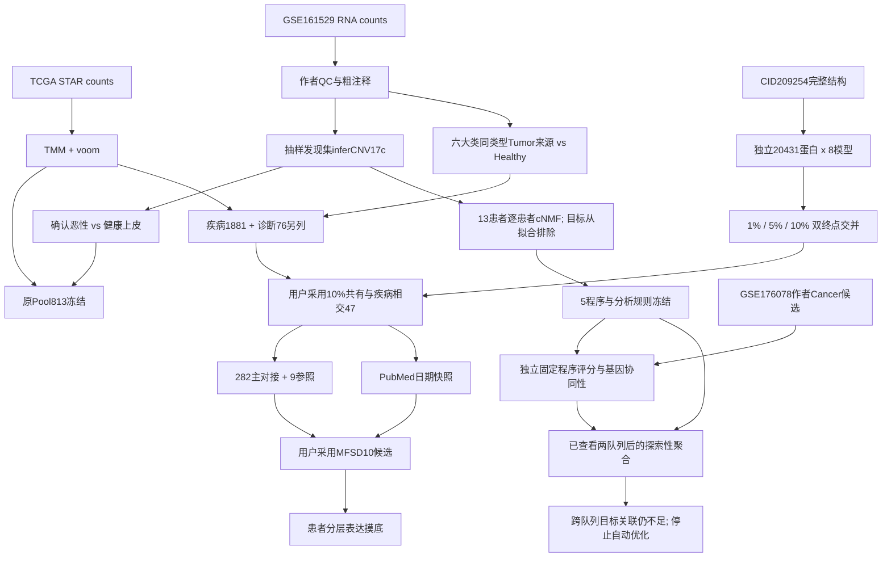

# 输入输出依赖概览

这是主要数据依赖，不代表每个动态文件引用都已静态解析。精确旧目录、代码、报告和完成记录见[stages.json](../config/stages.json)，字面路径线索见本次审计。小文件恢复不等于大数据依赖已恢复。

DeepPurpose1881池内10模型计算也已保留，但独立全蛋白筛选不是把池内分数直接当全背景百分位。Pool813与1881不是同一集合；程序共表达复现不等于MFSD10作用机制验证。
