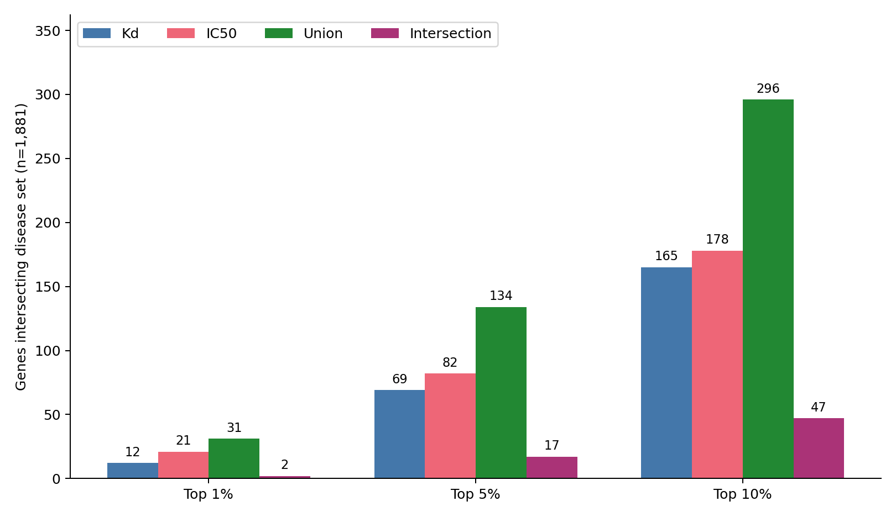
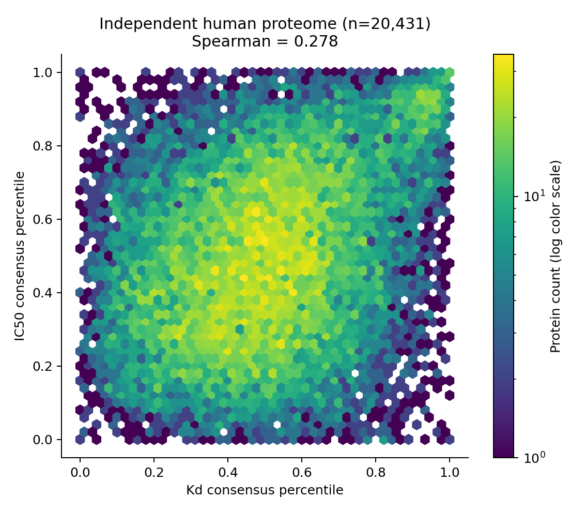

# Spiropachysine A 身份核对与独立药物侧预测

已确认 Spiropachysine A 与 PubChem CID209254（Spiropachysine）对应同一完整立体结构。已完成独立人类已审校蛋白背景20,431条×8个DeepPurpose预训练模型，共163,448个原始分数；按用户要求完整报告前1%、5%、10%，分别给出Kd、IC50、交集及并集，再与疾病1,881基因相交。暂不指定唯一主阈值。

## 结构依据

Halaczkiewicz等原始合成研究的公开作者稿Figure1明确标注Spiropachysine A，并给出九个完整立体中心，[发表DOI10.1002/chem.202404223](https://doi.org/10.1002/chem.202404223)。清除CID原有立体标签，再从原图九条楔形/虚线键重新赋型，九中心及完整结构键均一致：`SLGWGPQWJRVPAD-PZOAWPBASA-N`。图中A与CID209254完全对应，B/ISO是独立成分。[身份核对结论](身份核对结论.md)、[逐中心核验](structure_comparison/Published_A_Figure1_reconstruction.json)、[原图](sources/Synthesis_A_structure_detail.png)。

模型实际输入是等价规范异构SMILES92字符，避免101字符原串被CNN的100字符上限截断。

## 独立预测如何完成

背景为本地存档UniProt release2026_03全部20,431条人类Swiss-Prot canonical条目、20,353条唯一序列。未用疾病名单选背景。映射针对完整GENCODEv36 protein_coding参考，以精确Ensembl GeneId及全参考内唯一主基因符号完成，本地处理，无候选名单外传。

每个终点分别采用CNN_CNN、Morgan_CNN、Morgan_AAC、Daylight_AAC四个预训练编码；将原始预测值在全部20,431条蛋白内转为平均秩百分位，再取四模型百分位中位数。共识降序排名取前ceil(N×比例)，边界并列全纳入。先固定蛋白集合，再映射成基因集合；终点交并集在基因层面计算，最后才与疾病侧相交。不同蛋白可对应相同或多个参考基因，因此蛋白数与基因数不同。

Kd与IC50保持各自终点，不合并原分数。两个MPNN因前期复现批次依赖而不纳入本次共识。所有模型均来自BindingDB：多编码和多终点用于检查一致性与降低单模型依赖，不能消除共享数据库偏置。本次输出用于候选排序，阈值是排名范围，并非经实验校准的阳性界值。

## 三档结果

下表为最终与疾病1,881基因相交后的数量，交集/并集均指Kd与IC50的基因集合。

| 排名范围 | Kd∩疾病 | IC50∩疾病 | 两终点并集∩疾病 | 两终点交集∩疾病 |
|---|---:|---:|---:|---:|
| 1% | 12 | 21 | 31 | 2 |
| 5% | 69 | 82 | 134 | 17 |
| 10% | 165 | 178 | 296 | 47 |

独立药物侧集合本身的基因数：

| 排名范围 | Kd基因 | IC50基因 | 两终点并集 | 两终点交集 |
|---|---:|---:|---:|---:|
| 1% | 201 | 199 | 360 | 40 |
| 5% | 980 | 946 | 1605 | 321 |
| 10% | 1949 | 1880 | 3077 | 752 |

独立蛋白条目选择数：

| 排名范围 | Kd蛋白 | IC50蛋白 | 共有蛋白 |
|---|---:|---:|---:|
| 1% | 205 | 205 | 39 |
| 5% | 1022 | 1022 | 340 |
| 10% | 2044 | 2044 | 791 |

- 前1%两终点共有、且属于疾病侧：2基因。符号：NR3C1, PNP。
- 前5%两终点共有、且属于疾病侧：17基因。符号：CA12, TSPAN13, PMP22, MFSD10, NR3C1, PPARG, EMP1, ADRA2A, MFSD12, TMC4, AGPAT2, S1PR1, PTGER4, GPR160, SSTR2, PNP, MT-ND4。
- 前10%两终点共有、且属于疾病侧：47基因。符号：GPRC5A, CYBRD1, CA12, FXYD3, ITPR3, SCD, TSPAN13, PMP22, MFSD10, NR3C1, APH1A, F3, ORMDL2, PPARG, TMEM254, EMP1, KCNK1, PIGC, TSPAN3, MALL, SLC18B1, MAL2, ADRA2A, SAMD8, ATP5MC1, MFSD12, IFI27, VKORC1, TMC4, AGPAT2, S1PR1, PTGER4, GPR160, MYADM, SSTR2等；完整见对应交集表。

两终点全背景共识Spearman相关系数为0.2777。逐次去掉一个编码后，候选蛋白集合与四模型集合的Jaccard如下；它反映对编码选择的敏感性。

| 终点 | 范围 | 留一编码Jaccard范围 |
|---|---:|---:|
| IC50 | 1% | 0.547–0.612 |
| IC50 | 5% | 0.526–0.607 |
| IC50 | 10% | 0.582–0.643 |
| Kd | 1% | 0.424–0.571 |
| Kd | 5% | 0.491–0.586 |
| Kd | 10% | 0.506–0.576 |

## 覆盖与疾病证据

1,881个疾病基因全部可映射到本次已审校蛋白背景，覆盖率100%。这次映射先针对完整GENCODEv36参考完成，再匹配疾病基因，未按疾病名单额外添加GENCODE-only翻译。每基因对应的已审校蛋白条目及映射方法均可追溯。

主疾病输入为六个生物学大类细胞级双向DE并集∩既定Bulk DE∩protein_coding。表内保留细胞类型、Bulk方向/统计、单细胞上下调与患者PB支持；PB不作新增硬门槛。额外76个Mixed/Unresolved-only基因另表报告，不混入1,881主集。全背景2407条序列超过CNN的1,000残基上限，25条含非标准字符，逐条标记，AAC使用全序列。

## 文件与复现

- [三档数量总表](results/Threshold_comparison_1_5_10percent.tsv)
- [全部1,881基因独立预测与疾病证据](results/All1881_disease_genes_independent_prediction_evidence.tsv)
- [Kd全人类背景排序](results/Kd_independent_proteome_ranked.tsv)、[IC50全背景排序](results/IC50_independent_proteome_ranked.tsv)
- 独立药物集合：results/independent_drug_sets；十二组主疾病交集及额外76诊断交集：results/disease_intersections。
- [全部163,448原始分数](results/All_independent_protein_model_scores.tsv)、[留一编码敏感性](results/Leave_one_encoding_out_threshold_stability.tsv)
- [未覆盖疾病基因](results/Disease_genes_outside_reviewed_background.tsv)、[冻结协议](background/Frozen_independent_drug_side_protocol.json)

验收33/33通过：独立复算全部百分位/秩/边界并列及十二组集合、全量分数与权重哈希、疾病输入和原第一阶段七份冻结结果均一致。原生AAC缓存1,993×8,420元素和另55例编码对照完全一致；每模型16个实际蛋白对照原生前向，最大差异9.54e-07；既有原生预测的共享序列亦完成分数比较。详见[audit验收表](audit/Independent_result_validation.tsv)。

恢复顺序：scripts/run_independent_prediction.py → summarize_independent_intersections.py → audit_independent_results.py → write_independent_report.py。已完成模型按分数/输入/权重哈希断点复用。原813池、前轮1,881池内评分及所有单细胞结果保留。

## 已有乳腺癌文献

Zhai2012原始论文[10.1021/np300207c](https://doi.org/10.1021/np300207c)已有乳腺癌迁移筛选。已读摘要及官方补充材料；摘要的integrinβ1机制属于terminamine A（化合物1），不移用于本药。Spiropachysine在已知化合物8–14的具体编号仍需正文核对，后续机制解读与查新时继续处理。它不改变本次独立预测与取交集结果。
