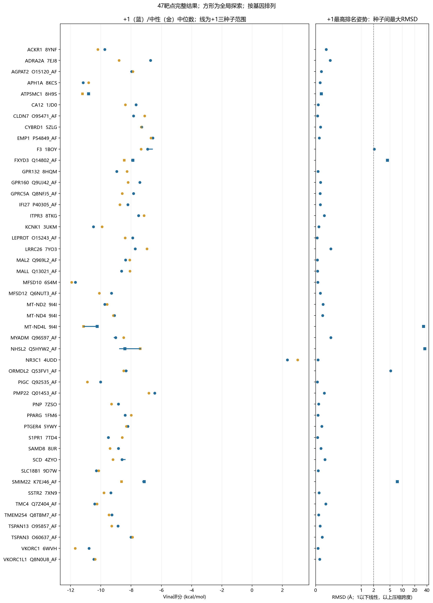
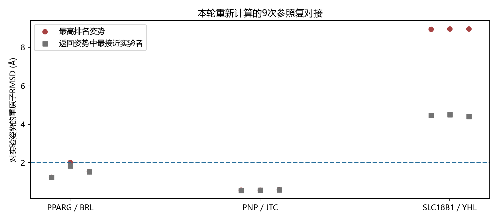

# 47个共有靶点反向对接结果

完成日期：2026-10-25 04:26:21 +0800。按用户确认的方案完成47靶点×两状态×三种子＝282次主对接，另完成9次参照复对接。旧两候选对接结果已清除，本报告仅使用新一轮计算。

## 这轮结果支持怎样继续

47个对象均已有实际对接结果，下表逐项列出结构支持和建议的下一步。主状态为pH7.4规则生成的+1，中性状态单列；每个数值为三种子中位数。主攻靶点仍需结合这47项证据与你讨论确定。

判断依据是姿势质量、三种子位置一致性、实际目标链接触、位点来源和局部结构可信度；表内不设统一Vina分数阳性线。全局探索单列解释。

| 靶点 | +1中位数 | 中性中位数 | +1种子最大RMSD Å | 结构支持 | 后续建议 |
|---|---:|---:|---:|---|---|
| ACKR1 | -9.742 | -10.199 | 0.23 | 有可重复姿势，位点为预测 | 可进入结合预实验，并核查预测位点 |
| ADRA2A | -6.712 | -8.798 | 0.32 | 当前结构支持不足 | 先解决表内具体问题，再投入位点机制实验 |
| AGPAT2 | -7.966 | -7.878 | 0.13 | 有可重复姿势，位点为预测 | 可进入结合预实验，并核查预测位点 |
| APH1A | -11.178 | -10.809 | 0.10 | 有可重复的目标-伙伴界面姿势 | 可检验复合物相关结合，并区分具体结合亚基 |
| ATP5MC1 | -10.810 | -11.216 | 0.12 | 获得全局探索线索 | 先核查局部位点和模型，再决定实验优先级 |
| CA12 | -7.670 | -8.375 | 0.06 | 有可重复的结构支持 | 可进入小规模结合与药效依赖性验证 |
| CLDN7 | -7.844 | -7.108 | 0.04 | 有可重复姿势，位点为预测 | 可进入结合预实验，并核查预测位点 |
| CYBRD1 | -7.301 | -7.320 | 0.10 | 有可重复的结构支持 | 可进入小规模结合与药效依赖性验证 |
| EMP1 | -6.564 | -6.688 | 0.08 | 有可重复姿势，位点为预测 | 可进入结合预实验，并核查预测位点 |
| F3 | -6.903 | -7.335 | 2.07 | 有结构可行性，最高姿势尚不一致 | 可做结合预实验，具体结合方式继续核验 |
| FXYD3 | -7.883 | -8.454 | 4.34 | 获得全局探索线索 | 先核查局部位点和模型，再决定实验优先级 |
| GPR132 | -8.945 | -8.272 | 0.05 | 有可重复的结构支持 | 可进入小规模结合与药效依赖性验证 |
| GPR160 | -7.425 | -8.195 | 0.10 | 有可重复姿势，位点为预测 | 可进入结合预实验，并核查预测位点 |
| GPRC5A | -7.835 | -8.596 | 0.10 | 当前结构支持不足 | 先解决表内具体问题，再投入位点机制实验 |
| IFI27 | -8.218 | -8.748 | 0.10 | 当前结构支持不足 | 先解决表内具体问题，再投入位点机制实验 |
| ITPR3 | -7.504 | -7.148 | 0.19 | 有可重复的结构支持 | 可进入小规模结合与药效依赖性验证 |
| KCNK1 | -10.495 | -9.925 | 0.07 | 有可重复姿势，位点为预测 | 可进入结合预实验，并核查预测位点 |
| LEPROT | -7.899 | -8.392 | 0.03 | 有可重复姿势，位点为预测 | 可进入结合预实验，并核查预测位点 |
| LRRC26 | -7.730 | -6.948 | 0.33 | 有可重复的目标-伙伴界面姿势 | 可检验复合物相关结合，并区分具体结合亚基 |
| MAL2 | -8.367 | -8.086 | 0.04 | 有可重复姿势，位点为预测 | 可进入结合预实验，并核查预测位点 |
| MALL | -8.629 | -8.077 | 0.04 | 有可重复姿势，位点为预测 | 可进入结合预实验，并核查预测位点 |
| MFSD10 | -11.683 | -11.934 | 0.04 | 有可重复姿势，位点为预测 | 可进入结合预实验，并核查预测位点 |
| MFSD12 | -9.298 | -10.102 | 0.10 | 有可重复姿势，位点为预测 | 可进入结合预实验，并核查预测位点 |
| MT-ND2 | -9.737 | -9.592 | 0.16 | 有可重复的目标-伙伴界面姿势 | 可检验复合物相关结合，并区分具体结合亚基 |
| MT-ND4 | -9.109 | -9.166 | 0.15 | 有可重复的目标-伙伴界面姿势 | 可检验复合物相关结合，并区分具体结合亚基 |
| MT-ND4L | -10.235 | -11.147 | 33.01 | 最高排名归于伙伴，另有目标相关候选 | 保留返回姿势线索，先明确具体结合亚基 |
| MYADM | -9.017 | -8.490 | 0.33 | 有可重复姿势，位点为预测 | 可进入结合预实验，并核查预测位点 |
| NHSL2 | -8.406 | -7.392 | 35.31 | 获得全局探索线索 | 先核查局部位点和模型，再决定实验优先级 |
| NR3C1 | 2.341 | 3.021 | 0.05 | 当前结构支持不足 | 先解决表内具体问题，再投入位点机制实验 |
| ORMDL2 | -8.334 | -8.494 | 5.20 | 有结构可行性，最高姿势尚不一致 | 可做结合预实验，具体结合方式继续核验 |
| PIGC | -10.021 | -10.898 | 0.04 | 有可重复姿势，位点为预测 | 可进入结合预实验，并核查预测位点 |
| PMP22 | -6.439 | -6.823 | 0.19 | 有可重复姿势，位点为预测 | 可进入结合预实验，并核查预测位点 |
| PNP | -8.837 | -9.301 | 0.06 | 有可重复的结构支持 | 可进入小规模结合与药效依赖性验证 |
| PPARG | -8.389 | -7.996 | 0.05 | 有可重复的结构支持 | 可进入小规模结合与药效依赖性验证 |
| PTGER4 | -8.218 | -8.308 | 0.13 | 有可重复的结构支持 | 可进入小规模结合与药效依赖性验证 |
| S1PR1 | -9.511 | -8.592 | 0.04 | 结果对药物状态敏感，中性姿势可用 | 保留中性状态结合假说，优先检验实际条件下的结合 |
| SAMD8 | -8.845 | -9.393 | 0.11 | 有可重复的结构支持 | 可进入小规模结合与药效依赖性验证 |
| SCD | -8.600 | -9.204 | 0.20 | 有可重复的结构支持 | 可进入小规模结合与药效依赖性验证 |
| SLC18B1 | -10.299 | -10.142 | 0.05 | 有计算姿势，参照姿势验证未通过 | 可结合功能线索讨论预实验，精确位点结论暂不采用 |
| SMIM22 | -7.136 | -8.627 | 7.54 | 获得全局探索线索 | 先核查局部位点和模型，再决定实验优先级 |
| SSTR2 | -9.341 | -9.799 | 0.08 | 有可重复的结构支持 | 可进入小规模结合与药效依赖性验证 |
| TMC4 | -10.402 | -10.250 | 0.22 | 有可重复姿势，位点为预测 | 可进入结合预实验，并核查预测位点 |
| TMEM254 | -9.274 | -9.467 | 0.06 | 有可重复姿势，位点为预测 | 可进入结合预实验，并核查预测位点 |
| TSPAN13 | -8.867 | -9.290 | 0.09 | 有可重复姿势，位点为预测 | 可进入结合预实验，并核查预测位点 |
| TSPAN3 | -8.009 | -7.904 | 0.14 | 有可重复姿势，位点为预测 | 可进入结合预实验，并核查预测位点 |
| VKORC1 | -10.776 | -11.697 | 0.05 | 有可重复的结构支持 | 可进入小规模结合与药效依赖性验证 |
| VKORC1L1 | -10.457 | -10.377 | 0.09 | 有可重复姿势，位点为预测 | 可进入结合预实验，并核查预测位点 |

282个最高排名姿势的身份/立体信息及基本分子几何检查均通过；268个通过本轮受体距离检查。ADRA2A与NR3C1在两状态均有距离问题，NR3C1当前口袋中的评分还为正值；S1PR1的+1姿势存在距离问题，而中性状态三次均通过，因此按状态敏感处理。GPRC5A、IFI27的主要问题是实际接触区域模型可信度偏低。各项原始指标均保留在检查表中。

## 复合物中的姿势归属

下表按+1状态三次最高排名姿势，分别统计4Å内接近目标链和伙伴链的药物重原子数。两类计数可以重叠；它们描述接触位置，不是能量分解。

| 靶点 | 目标链接触数范围 | 伙伴链接触数范围 | 当前解释 |
|---|---:|---:|---|
| APH1A | 10–10 | 13–13 | 有可重复的目标-伙伴界面姿势 |
| ATP5MC1 | 19–20 | 6–6 | 获得全局探索线索 |
| LRRC26 | 5–5 | 9–11 | 有可重复的目标-伙伴界面姿势 |
| MT-ND2 | 8–8 | 13–15 | 有可重复的目标-伙伴界面姿势 |
| MT-ND4 | 16–16 | 25–26 | 有可重复的目标-伙伴界面姿势 |
| MT-ND4L | 0–0 | 23–23 | 最高排名归于伙伴，另有目标相关候选 |

**MT-ND4L的具体情况：**最高排名姿势距目标链最近重原子仍为7.95–11.50Å，原主评分对应伙伴附近的位置。
进一步核对每次已返回的20个姿势，三次均能找到至少5个药物重原子在4Å内接近目标的候选，分别排第3/4/3位，评分分别为-9.725/-10.636/-9.698 kcal/mol；这三个候选姿势相互RMSD为0.03–0.07Å。它们作为目标相关返回姿势另列，保持原主评分与排名。
[返回姿势逐项归属记录](audit/MT-ND4L_returned_pose_target_attribution_diagnostic.json)。下一步判断应区分复合物结合与具体亚基归属。

[完整47行证据与具体理由](results/47_integrated_docking_disease_evidence.tsv)包含Bulk方向、单细胞来源、患者PB、独立预测排名、PubMed结果及逐靶点理由。[逐细胞类型完整疾病证据](results/47_target_celltype_disease_evidence.tsv)保留统计量和PB方向。

## 全47结果图

蓝点为+1状态、金点为中性状态，横线为+1三次分数范围；方形表示全局探索。右图比较种子间姿势，1Å以下为线性刻度，以上压缩跨度；2Å仅作位置一致性的描述参照。按基因排列，未把跨受体原始分数直接当成真实亲和力排序。

## 本轮参照复对接

| 体系 | 最高排名姿势达到2Å | 返回姿势中至少一个达到2Å |
|---|---:|---:|
| PPARG | 2/3 | 3/3 |
| PNP | 3/3 | 3/3 |
| SLC18B1 | 0/3 | 0/3 |

参照结果仅评价对应受体和设置；逐次RMSD、评分及计算方式见[参照表](results/Redocking_control_results.tsv)。

## 五个全局探索与六个查新重点

- **MFSD10：**有可重复姿势，位点为预测。主状态三种子姿势收敛、几何可用且接触目标链；实际采用的预测口袋P2Rank概率为0.991。可进入结合预实验，并核查预测位点。疾病背景：上调类型Fibroblast；下调类型无；患者PB支持Fibroblast。
- **NHSL2：**获得全局探索线索。最高排名姿势在种子间位置不同；全局探索，需要进一步定位可重复的局部位点。先核查局部位点和模型，再决定实验优先级。疾病背景：上调类型Endothelial；下调类型无；患者PB支持Endothelial。
- **SLC18B1：**有计算姿势，参照姿势验证未通过。主状态三种子姿势收敛、几何可用且接触目标链；本轮参照最高排名姿势0/3达到2Å。可结合功能线索讨论预实验，精确位点结论暂不采用。疾病背景：上调类型无；下调类型Epithelial；患者PB支持Epithelial。
- **TMEM254：**有可重复姿势，位点为预测。主状态三种子姿势收敛、几何可用且接触目标链；实际采用的预测口袋P2Rank概率为0.114。可进入结合预实验，并核查预测位点。疾病背景：上调类型Epithelial；下调类型无；患者PB支持Epithelial。
- **TSPAN3：**有可重复姿势，位点为预测。主状态三种子姿势收敛、几何可用且接触目标链；实际采用的预测口袋P2Rank概率为0.189。可进入结合预实验，并核查预测位点。疾病背景：上调类型无；下调类型Immune；患者PB支持Immune。
- **SAMD8：**有可重复的结构支持。主状态三种子姿势收敛、几何可用且接触目标链。可进入小规模结合与药效依赖性验证。疾病背景：上调类型无；下调类型Epithelial;Fibroblast；患者PB支持Epithelial;Fibroblast。

五个严格PubMed0命中与SAMD8机构缩写消歧附列保留区分；查新信息用于讨论创新性，47个对象的计算范围不受它过滤。ATP5MC1、FXYD3、MT-ND4L、NHSL2、SMIM22的全局网格、姿势和质量数据均保留。

## 方法与可复查文件

使用Vina1.2.7、exhaustiveness64、seed20261024/25/26、最多20姿势。25个靶点采用实验结构，共23个不同PDB条目；其余22个采用AF模型。实际网格与结构选择在计算前固定。[完整固定方案](47靶点对接_计算方案.md)与[47实际网格](inputs/47_actual_search_regions.tsv)。

受体逐残基映射，去融合段，按生物学组装保留目标和必要伙伴；模板补缺失重原子，已解析原子固定。金属与辅因子逐项留档。基本几何采用PoseBusters配置；受体/辅因子距离用全部保留重原子计算；种子RMSD和参照RMSD均在受体坐标系中作对称性校正，不先对齐配体。

[282个最高排名姿势检查](results/All_completed_top_pose_checks.tsv)、[94组分状态汇总](results/Target_state_summary.tsv)、[种子RMSD](results/Seed_pose_pairwise_RMSD.tsv)。docking保留全部原始姿势、命令、输入SHA256和日志；poses保留全部返回姿势的三维SDF。

方法依据：[Vina官方教程](https://autodock-vina.readthedocs.io/en/latest/docking_basic.html)、[Vina搜索空间与评分说明](https://autodock-vina.readthedocs.io/en/latest/faq.html)、[P2Rank作者文档](https://github.com/rdk/p2rank)。局部/全局搜索结果按其实际覆盖解释；当前研究选择的下一步是结合及药效依赖性实验。
