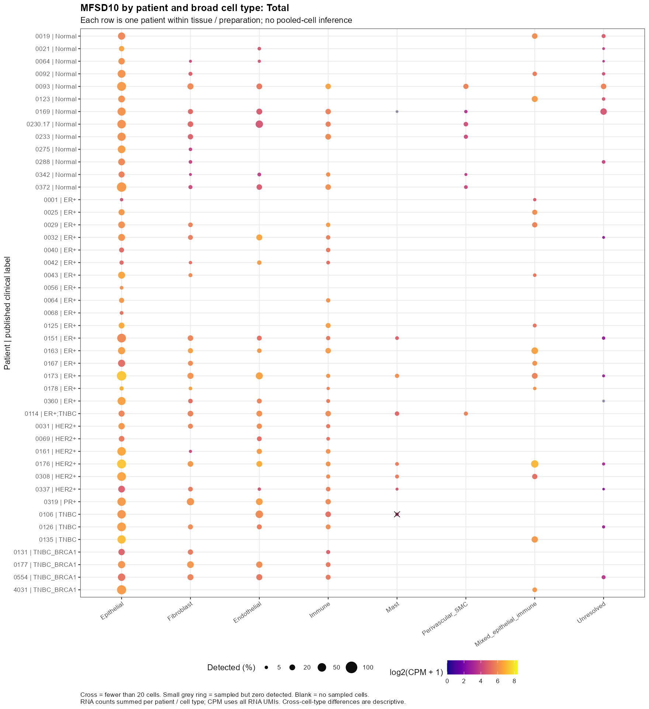
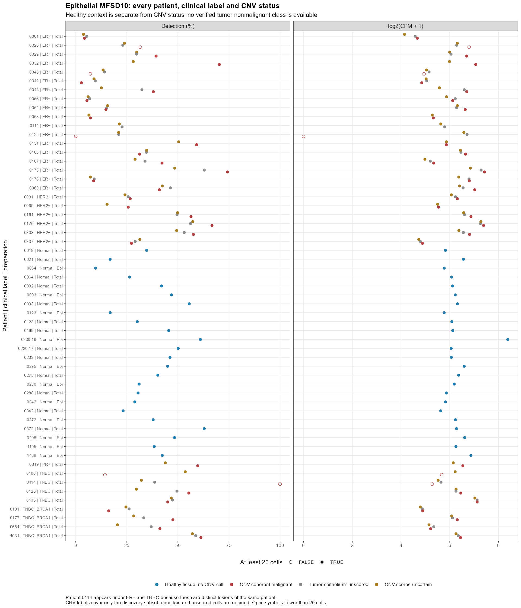
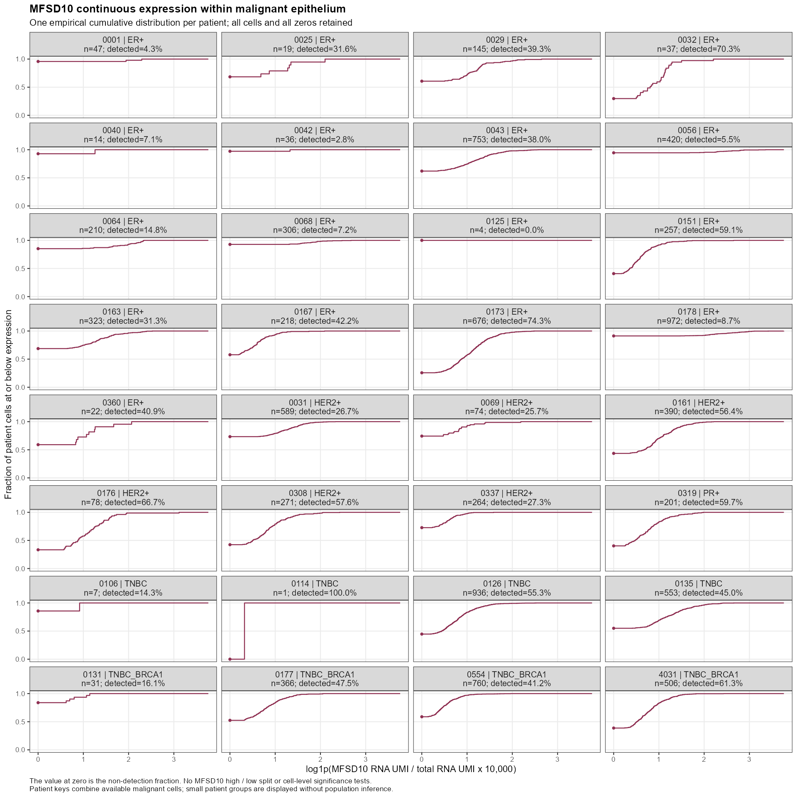
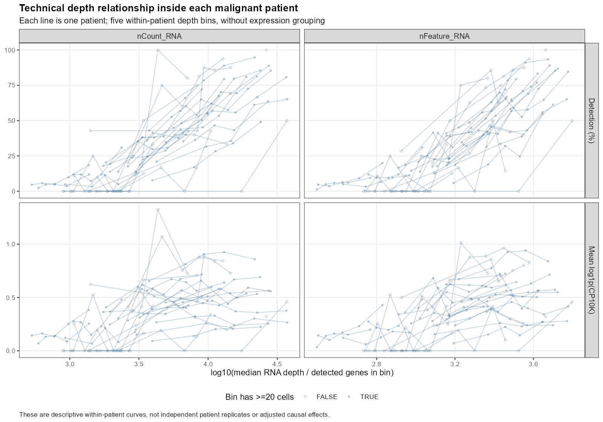

# MFSD10表达分布摸底结果

完成日期：2026-10-26。研究对象GSE161529；本轮只描述表达分布，不预设机制，不划分MFSD10高低组。

**主要观察：MFSD10的检出分布以本数据的上皮细胞更普遍，成纤维、内皮及免疫细胞也有信号；恶性上皮信号跨多个患者存在，但零值多、患者间差异明显，并伴随测序深度关系。现有数据不支持将这些表达分布直接写成机制或细胞特异性结论。**

## 1. 实际可用信息与缺失项

69个文库共340,979个既有QC保留细胞，涉及54个操作性患者/供者键。分层如下，列内患者数不可跨行相加：

| 来源与制备 | 文库 | 患者/供者 | QC细胞 | 现有粗注释 |
|---|---:|---:|---:|---|
| 原发肿瘤 Total | 34 | 32 | 181,977 | 有 |
| 健康乳腺 Total | 13 | 13 | 54,332 | 有 |
| 健康乳腺上皮富集 | 11 | 11 | 53,716 | 有，含少量其他大类 |
| 癌前 Total | 4 | 4 | 23,240 | 无 |
| 受累淋巴结，具体制备方式未明确 | 7 | 7 | 27,714 | 无 |

58个文库已有Seurat对象和细胞粗注释。患者/临床信息来自已核对的文库映射表，粗注释来自独立cell_identity表；Seurat对象本身主要存RNA counts、QC和聚类字段。实际使用字段、来源、逐库状态见[临床与样本总表](metadata/Library_clinical_context.tsv)、[字段可用性表](metadata/Clinical_field_availability.tsv)和[方法与字段说明](方法与字段说明.md)。

可用临床标签为ER+、PR+、HER2+、TNBC、TNBC_BRCA1；年龄和性别可用，部分有组织学、ER文字描述、分级、尺寸、BRCA1变异或HER2扩增。没有在本轮核对的元数据中找到统一PAM50、完整ER/PR/HER2定量、TNM或治疗随访信息，不按样本名前缀补填。PR+患者0319保留原标签，不改成ER+。

患者0029的两个区域合并；患者0114的两个病灶分别为ER+和TNBC：大类总览只占一个患者行，临床上皮图保留两个病灶标签，但共用患者身份。健康与肿瘤0064不是同一人。Total与上皮富集保持分层。

**恶性标签缺口：**17c主结果覆盖29,113个发现集肿瘤上皮，其中9,486为CNV一致性支持恶性、19,627为未定；其余93,898个肿瘤来源上皮未评分。没有完整、独立确认的“肿瘤内非恶性上皮”标签。健康来源上皮按组织背景单列，不能把未定或未评分者改称非恶性。因此图2展示恶性、未定、未评分及健康背景四种状态，未强行二分。

淋巴结及癌前11个文库仅作QC后全样本混合细胞表达描述，见[对应表](results/Unannotated_LN_preneoplastic_mixture_only.tsv)。没有用组织来源猜细胞类型，也没有补做CNV或把它们称为恶性上皮。

## 2. 信号来自哪些细胞

下表为原发肿瘤Total中每患者×细胞类型至少20细胞的描述性汇总；患者等权，保留所有非显著和小样本明细。CPM是相对RNA丰度，不是跨细胞类型的绝对分子量。

| 大类 | 可描述患者数 | 患者检出率中位数 | 患者pseudobulk CPM中位数 |
|---|---:|---:|---:|
| Epithelial | 32 | 31.5% | 72.3 |
| Fibroblast | 20 | 14.4% | 54.4 |
| Endothelial | 17 | 16.2% | 61.1 |
| Immune | 24 | 10.3% | 49.9 |
| Mast | 6 | 7.3% | 38.4 |
| Perivascular_SMC | 1 | 8.7% | 49.3 |

上皮在32个原发肿瘤患者中均有检出；成纤维20/20、内皮17/17、免疫24/24个达到细胞数门槛的患者组也均有检出。由此不能将MFSD10视为成纤维或恶性上皮专属信号。健康Total上皮13名供者也均有检出，患者检出率中位数40.2%；健康上皮富集为38.4%。这些数字不构成肿瘤/正常差异检验。

Mast正常侧只有1名可描述供者，肿瘤Perivascular_SMC也只有1名，不能作患者群体推广。Mixed/Unresolved为诊断组，未升级为精细免疫亚群。

[全组织患者大类图](figures/01_Total_patient_celltype.png)｜[正常上皮富集分层图](figures/01_Epithelial_enriched_patient_celltype.png)

## 3. 恶性上皮内：患者差异、稀疏性与集中程度

9,486个恶性上皮细胞来自32名患者；其中27名至少20个恶性细胞，另5名仅1–19个。总体检出率39.7%，即60.3%细胞为零；检出细胞中55.6%仅有1个UMI。零值不能等同真实不表达。

27名可描述患者全部有检出，患者检出率中位数40.9%，范围2.8%–74.3%。患者0114仅1个恶性细胞，虽显示100%检出也不能解释为该患者高表达；0125仅4个恶性细胞未检出，同样不能解释为该患者基因缺失。其他少样本为0106（7个）、0040（14个）、0025（19个）。

原始MFSD10 UMI最多的患者0173贡献18.8%，前三名0173/0126/4031合计42.4%。这说明总量存在患者集中，且受细胞数和深度影响；但信号不是只由这些患者产生。27名患者等权CPM中位数为86.6，逐一去掉任一患者后为86.2–89.2，未因单个患者消失。

| 公开临床标签 | 有恶性细胞患者 | 至少20个恶性细胞患者 | 恶性细胞总数 |
|---|---:|---:|---:|
| TNBC | 4 | 2 | 1497 |
| TNBC_BRCA1 | 4 | 4 | 1663 |
| HER2+ | 6 | 6 | 1666 |
| PR+ | 1 | 1 | 201 |
| ER+ | 17 | 14 | 4459 |

TNBC仅2名患者达到20个恶性细胞、PR+只有1名患者；各亚型与患者/细胞数明显不均衡。本轮展示逐患者结果，不宣称亚型特异表达或作亚型间群体推断。0114的ER+病灶在本轮17c中没有获判恶性的细胞，其已判恶性细胞来自TNBC病灶。

## 4. 技术混杂检查

每患者内单独计算描述性Spearman相关，不用细胞数制造P值。27名至少20细胞者中，25名另有至少5个检出细胞，适合摘要描述；0001和0042检出仅2个/1个，相关另标稀疏。

| 与QC的关系 | nCount_RNA：患者相关中位数 | nFeature_RNA：患者相关中位数 |
|---|---:|---:|
| MFSD10原始counts | 0.380 | 0.374 |
| log1p(CP10K)连续表达 | 0.144 | 0.163 |
| 是否检出 | 0.329 | 0.343 |
| 剔除已有doublet标记：log1p(CP10K) | 0.141 | 0.144 |

标准化降低了与深度的相关，但未完全消除，检出率也受深度影响。两个患者的标准化表达与nCount相关达到0.3以上：0360（仅22个恶性细胞）及0131（31个），需尤其谨慎。扣除MFSD10自身对总UMI/特征数的贡献后，总体相关基本相同；剔除既有doublet标记也未使该关系消失。这些是技术关系诊断，不能判定残余差异一定来自技术或一定来自生物学。

患者pseudobulk同时提供CPM与同细胞类型内TMM_CPM，27个可描述恶性患者组二者排序Spearman约0.956。主图使用CPM，便于保留零值与清楚解释分母；TMM未用于跨细胞类型的绝对表达比较。标准化依据及公式见[方法说明](方法与字段说明.md)，参考[edgeR官方工作流](https://bioconductor.org/packages/release/workflows/vignettes/RnaSeqGeneEdgeRQL/inst/doc/edgeRQL.html)。

[逐患者QC相关图](figures/04b_malignant_patient_QC_rho.png)｜[完整相关与单细胞正值敏感性表](results/Malignant_patient_QC_correlations.tsv)

## 5. 交付与验收

- [患者×细胞类型汇总](results/Patient_broad_MFSD10_summary.tsv)：患者/来源/制备分层的细胞数、检出数、检出比例、原始UMI、CPM、TMM_CPM及低细胞数标志。
- [临床标签×上皮状态患者汇总](results/Patient_epithelial_MFSD10_summary.tsv)、[恶性患者连续分布摘要](results/Malignant_patient_continuous_summary.tsv)。
- [逐文库/样本明细](results/Library_celltype_and_epithelial_summary.tsv)、[逐细胞目标基因与QC表](results/MFSD10_cell_level.tsv.gz)。
- `cache/Patient_broad_pseudobulk_counts.rds`及`Patient_epithelial_pseudobulk_counts.rds`保留完整全基因原始pseudobulk计数，供复核标准化。
- [运行入口](scripts/run.ps1)，脚本00–04及R sessionInfo均保留；6组PNG+PDF构成4类展示内容。
- 17项计数/映射/分组检查通过；另直接从4个代表Seurat对象的RNA counts层复核目标计数、总UMI与nFeature一致。原第一阶段86份交付文件SHA256与冻结清单一致。

**边界：**本轮没有重注释、扩大CNV、细分免疫、划分MFSD10高低组或开展机制分析。表达分布与技术诊断不能证明药物直接结合、基因功能或乳腺癌因果机制。
