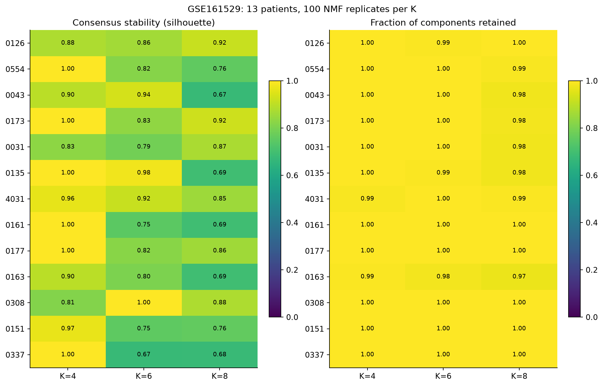
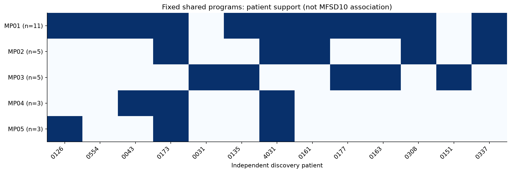
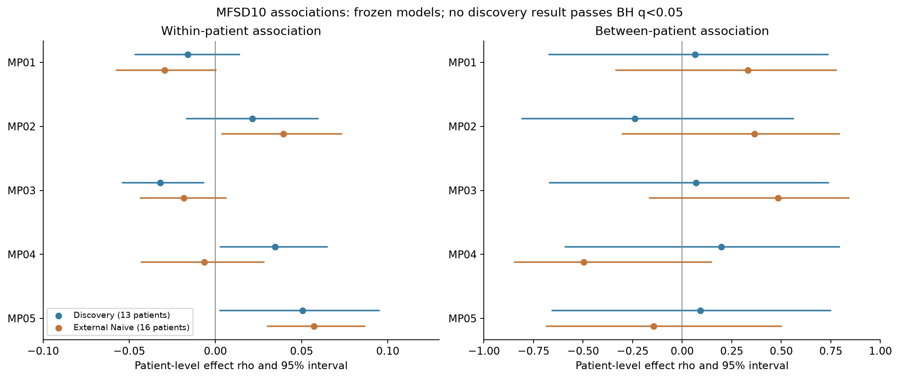
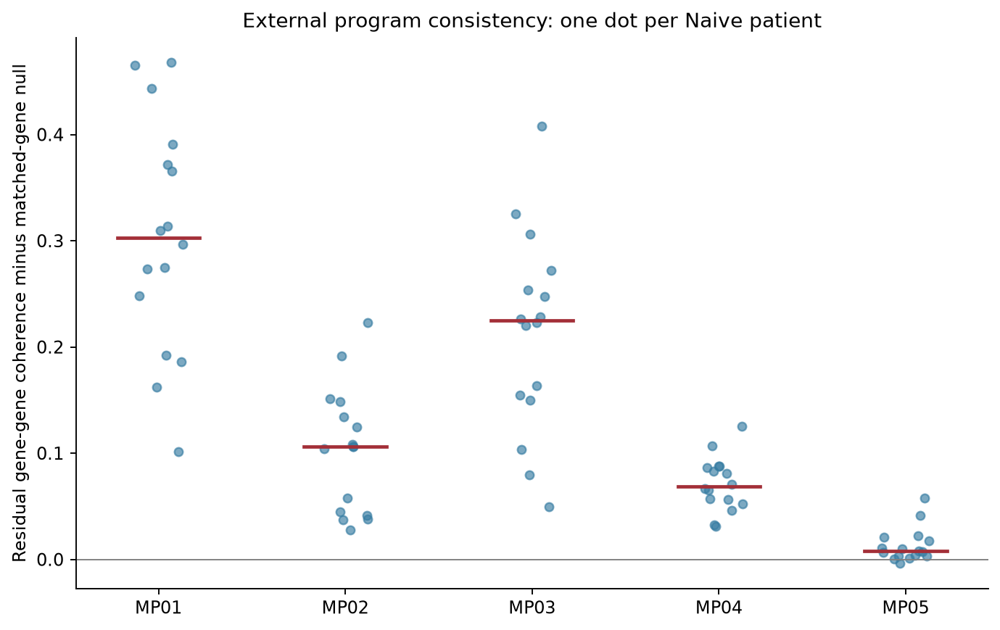
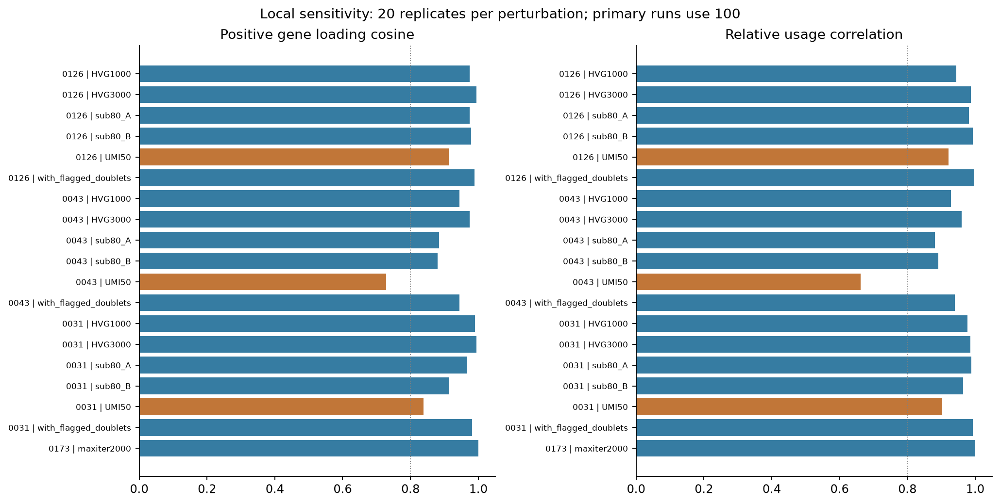

# MFSD10程序发现与独立验证结果

完成日期：2026-10-26。GSE161529发现、GSE176078外部验证分别处理，未联合整合或共同发现。

**结果支持5个候选共享表达程序在外部队列中具有基因协同性；当前没有建立通过发现集多重校正、再获外部确认的MFSD10关联。外部MP05的弱正相关属于探索性结果。**

## 数据及患者

- GSE161529完整图谱中未取得额外同标准已评分恶性细胞，故仍用17c的9,486个确认恶性中的8,722既有singlet；13名A/B候选共6,071个细胞参与逐患者拟合。未定/未评分不补入，抽样上限导致稀有程序可能遗漏。
- GSE176078实际下载在`原始数据/单细胞/GSE176078`。矩阵为基因×细胞，导入后100,064细胞×29,733基因、177,994,136非零，保持稀疏。整数非负、barcode唯一、metadata逐一对应、总UMI及基因数一致。MFSD10仅一个精确基因行；原始gene symbol及注释保留，另建规范ID。
- 补表1为26个唯一临床Case ID，与26样本显式映射；21Naïve、5Treated。最终作者Cancer Epithelial为24,489细胞、20名患者；其中16Naïve作为主要验证、4Treated分开。另6名患者在该最终矩阵无作者Cancer Epithelial细胞，不能据此称其肿瘤没有恶性细胞。
- 作者QC条件在现有100,064细胞中均满足，本轮没有再过滤。作者doublet字段未提供，记未知；谱系混合marker共检出只作疑义标记和敏感性，不直接判双细胞。作者恶性依据为inferCNV、基因组不稳定度及与肿瘤CNV模式相关的分群；本轮复用最终Cancer标签，未重跑inferCNV，未取得其全部逐细胞CNV数值。
- CID3963的metadata subtype为TNBC、补表显式IHC为ER+，保留冲突并用补表IHC作协变量；因治疗史也不进入主要Naïve验证。作者PAM50/scSubtype资料单独保存，不推断或冒充临床IHC。

[全部26患者及纳入理由](validation/GSE176078_all26_patient_summary.tsv)｜[病例-样本映射](metadata/GSE176078_patient_sample_clinical_map.tsv)｜[导入核验](audit/GSE176078_import_audit.json)

## cNMF与程序冻结

13患者×K4/6/8×100随机重复＝3,900次主分解。MFSD10从每个拟合输入、归一化分母与末端全基因重拟合物理排除，单独保留其表达。cNMF 1.7.1，2000HVG，max_iter1000；稳定性、重构及共识诊断用于K选择。程序先按跨K稳健、同患者去冗余及跨患者基因重叠归并，再形成固定50基因程序；未使用MFSD10相关性选择程序。

5个程序分别得到11/5/5/3/3名患者的独立发现支持。全部程序、基因、评分函数、统计代码及发现效应方向均在读取外部关联之前写入冻结清单，并在外部步骤验证SHA256。

[程序与基因](frozen/Program_genes_v1.tsv)｜[冻结规则及哈希](frozen/Analysis_freeze_v1.json)｜[各患者K诊断](discovery/All_patient_K_diagnostics.tsv)

## 支持与未支持的结果

表中关联为患者内partial Spearman经患者等权Fisher-z合并；控制目标剔除后的UMI、特征数及线粒体。q为全部5程序×患者内/患者间共10项联合BH。患者间结果另以患者pseudobulk及均值分析，调整显式临床IHC和技术指标，没有把细胞当独立患者。

| 程序 | 发现支持患者 | 发现患者内ρ / q | 外部患者内ρ / q | 外部协同性超额中位 / q |
|---|---:|---:|---:|---:|
| MP01 | 11 | -0.016 / 0.67 | -0.030 / 0.223 | 0.303 / 1.91e-05 |
| MP02 | 5 | 0.021 / 0.67 | 0.039 / 0.223 | 0.106 / 1.91e-05 |
| MP03 | 5 | -0.032 / 0.207 | -0.018 / 0.294 | 0.225 / 1.91e-05 |
| MP04 | 3 | 0.035 / 0.207 | -0.006 / 0.743 | 0.069 / 1.91e-05 |
| MP05 | 3 | 0.051 / 0.207 | 0.057 / 0.0029 | 0.008 / 0.000214 |

**MFSD10关联：**发现集最小BH q约0.207，患者内效应绝对值均不超过0.051，患者间也均未过校正。因此确认性外部检验清单为空，没有“验证成功”的靶点-程序关联。外部MP05患者内ρ约0.057、q约0.0029，方向与发现集一致，但发现集未通过校正；这里只能记作探索性支持，不能把外部显著性倒用于重新选择发现程序。其患者间关系未获支持。

**程序表达一致性：**固定基因覆盖94%–100%。在16名Naïve患者内，基因残差两两相关相较表达匹配随机基因集的协同性超额，对5程序均为正且BH<0.05；MP05外部协同性较弱。该证据独立于“分数较高”，支持固定基因程序的共表达，但不等同于重新分解得到完全相同的潜在因子。本轮采用固定基因评分，没有把均值评分称为完整cNMF谱的NNLS投射。

Treated仅4名有候选恶性细胞，患者数不足的关联只描述，未称验证成功。谱系混合标记排除敏感性另表；它不能替代真正doublet状态。所有不显著、方向不一致及不可估计结果完整保留。

[完整发现结果](discovery/MFSD10_patient_level_associations.tsv)｜[完整外部比较](validation/Discovery_external_comparison_all.tsv)｜[患者内明细](validation/MFSD10_within_patient_effects_Naive.tsv)｜[Treated单列表](validation/MFSD10_Treated_separate.tsv)

## 技术稳健性与限制

HVG1000/3000、两次80%细胞子抽样、50%UMI下采样、含已有doublet标记及增加迭代上限的局部敏感性均单列。0043在50%UMI下采样时分量中位余弦约0.729、usage相关约0.662，表明低深度可明显改变局部分解；不能宣称所有分量对测序深度均稳定。其余具体场景和分量也保留。

部分主重复出现max_iter1000提示。对明确日志提示的随机种子追加max_iter3000局部核验，报告谱变化；原主结果与冻结文件未覆盖。日志可能抑制重复提示，因此不能把提示条数当作完整的未收敛频次，也不能宣称所有随机重复均充分收敛。

原始程序分数与深度/基因数仍有关系，主关联已按患者内控制技术指标；剩余关联不能自动解释为生物机制。发现患者少、MFSD10稀疏、CNV发现集抽样及两个队列质量/注释来源不同，限制了效应精度和可推广性。未建立稳健关联不等于证明MFSD10无功能。

[分量级敏感性](discovery/Parameter_sensitivity_components.tsv)｜[迭代上限局部复核](discovery/Convergence_limit_followup.tsv)｜[技术关系图](figures/07_program_technical_relationships.png)｜[验证患者QC](figures/06_validation_patient_quality.png)

## 交付与复现

- 验证对象：`objects/GSE176078_all_cells_author_counts_clinical_v2.h5ad`、`objects/GSE176078_malignant_candidates_author_counts_clinical_v2.h5ad`；v1导入版本保留，主结果使用clinical_v2。
- 发现对象：`objects/GSE161529_confirmed_malignant_singlets_counts.h5ad`；目标表达仍在参考对象内，实际拟合副本排除了MFSD10。
- `scripts/run_pipeline.ps1`为阶段/标记恢复入口；各脚本、安装版本、日志、种子、原始3900个NMF谱及敏感性结果保留。无通讯、拟时序、GSEA或其他机制扩展。
- 结果完成状态只以`audit/PIPELINE_COMPLETED.json`为准；最终审计另核冻结哈希、全部3900谱、输入保护与必要输出。

方法来源：作者补表及[Wu等原文](https://doi.org/10.1038/s41588-021-00911-1)、[GEO](https://www.ncbi.nlm.nih.gov/geo/query/acc.cgi?acc=GSE176078)、[cNMF官方说明](https://github.com/dylkot/cNMF/blob/main/Stepwise_Guide.md)。本地完整核读记录及临床原件路径见`sources`、`metadata`和脚本。