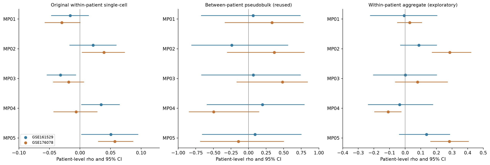
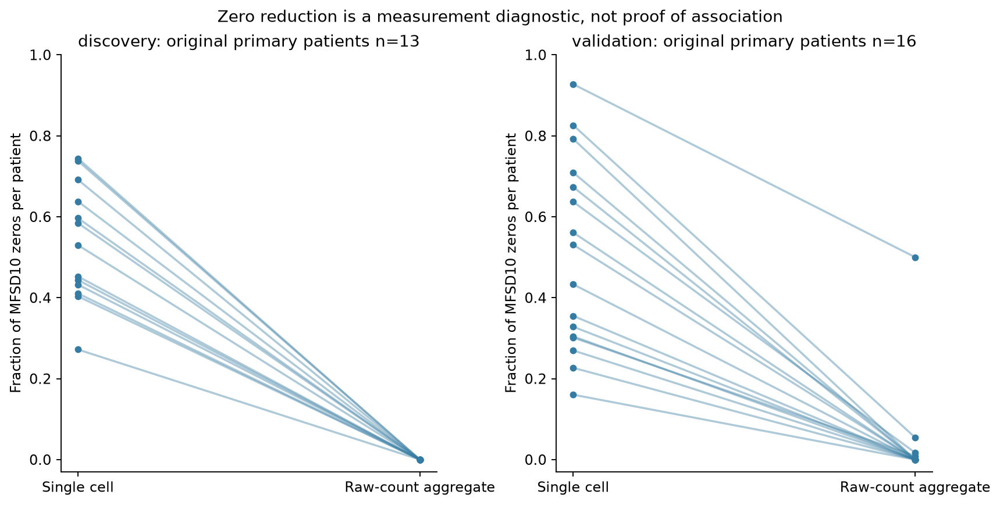
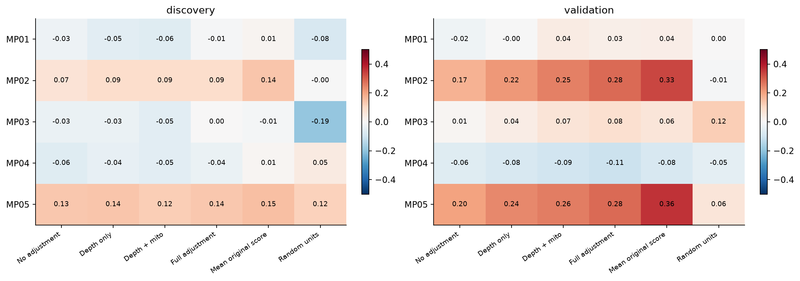

# MFSD10稀疏与聚合探索性再分析

**结论：聚合明显减少了观测零值，并增强了验证队列MP02/MP05的患者内关联；但没有补齐发现队列证据，整体尚不足以建立可靠的跨队列MFSD10关联。按本轮停止规则，不再继续优化这条表达程序关联路线。**

两个队列已查看，本轮所有新增结果均为探索性；不是新的预先独立确认性验证。5个程序及旧结果全部保留，未重跑NMF、未筛新signature、未做MAGIC/ALRA补值。

## 既有模型核查与复用

患者间分析原本已做：每患者恶性RNA counts求和、MFSD10 log2(CPM+1)与该患者原固定程序分数均值作偏秩相关。原13/16患者、IHC/深度/线粒体调整、效应CI/P/FDR全部原样复用；本轮全基因pseudobulk仅作原始counts审计，目标标准化数值和患者程序均分逐项与旧表相符。原单细胞患者内模型先控制UMI、基因数、线粒体，再每患者估计效应、患者级汇总，未把细胞当独立患者。

[原20项模型完整列表](results/Existing_models_reused_all20.tsv)｜[固定方案与方法](探索性再分析_固定规则.md)

## 非重叠状态聚合

每患者×样本单独构建约20细胞的容量约束邻域，MFSD10从状态特征、归一化及PCA输入排除，PCA状态另去除深度/线粒体线性成分；只用RNA counts，不用整合矩阵/UMAP。每细胞恰好一个单元，全基因UMI守恒。全部发现singlet形成425单元、验证作者候选形成1215单元；随机同容量分组另存。状态分组的平均PCA平方距离低于随机分组，说明确实聚合了更相近的状态。

冻结50基因的原log1p(CP10K)均分函数应用于单元counts，目标从分母排除；固定注释覆盖94%–100%。逐单元细胞数、总UMI、检出基因数和程序注释/实际检出覆盖均保存。非线性变换意味着聚合counts评分与原细胞均分不是同一个量，因此后者也单列敏感性，不把它们混同。

发现主要13患者均可估计；验证原16Naïve患者中，4465只有124细胞、6单元，按固定不足8单元规则不估计，主要聚合为15患者。其他患者未因MFSD10或P值筛选；不足的原因为单元数或残差自由度，详见完整表。相同13/15患者的旧效应也复用对照。

## 简洁对照

[打开完整三层简洁对照表](简洁对照表.md)｜[30项效应/CI/原始P/FDR/N](results/Comparison_all30_effects_CI_P_FDR_N.tsv)｜[逐患者效应与不可估原因](results/Aggregation_patient_effects_and_failures.tsv)

| 程序 | 发现聚合rho [95%CI]；q | 验证聚合rho [95%CI]；q | 判断 |
|---|---|---|---|
| MP01 | -0.006 [-0.222,0.203]；0.997 | 0.028 [-0.049,0.106]；0.734 | 近零，跨队列方向不一致 |
| MP02 | 0.088 [-0.030,0.201]；0.379 | 0.285 [0.174,0.421]；0.00137 | 正向一致，但发现不精确 |
| MP03 | 0.000 [-0.202,0.202]；0.997 | 0.079 [-0.062,0.271]；0.734 | 效应很弱，区间跨零 |
| MP04 | -0.035 [-0.236,0.177]；0.949 | -0.109 [-0.195,-0.026]；0.113 | 发现不精确；对评分/技术规格较敏感 |
| MP05 | 0.136 [-0.037,0.285]；0.37 | 0.282 [0.164,0.405]；0.00137 | 正向一致，但发现不精确；外部增强 |

原单细胞效应大多很弱；患者间点估计可有中等幅度，但CI很宽，不能简单说“效应都小”。精简到IHC+一个深度指标后，两队列患者间关联仍无多重校正支持，没有在13/16患者上追加一长串变量。

## 稀疏与技术因素是否解释了变化

原主要患者集的患者零值比例中位数：发现53.0%→0.0%，验证48.2%→0.0%。这是观测计数更充分，不等于每个细胞真的表达，也不等于恢复了单细胞真值。

验证MP02/MP05的rho升至约0.285/0.282，主10项BH均约0.00137；相同患者子集的旧结果比较，增强并非仅由少了一名患者造成。发现则约0.088/0.136、CI跨零、主q约0.379/0.370，不能把验证单队列增强说成跨队列证据已建立。

六个预定规格全部报告：不调整、仅深度、深度+线粒体、完整三技术调整、原细胞分数均值、随机同容量聚合。MP02/MP05在验证中的增强不只依赖一个评分变换或不控制深度；随机聚合信号较弱。不过发现效应仍不精确，无法据此证明稀疏性就是此前不显著的原因。弱信号中的翻向或调整敏感，不能直接断言是技术因果。

没有中等以上未调整效应符合本轮“调整后衰减至少一半”的技术解释较多判据；不为凑类别强行贴此标签。MP01/MP03主要是很弱/不稳定，MP02/MP05是同向但发现不精确，MP04对评分/调整规格敏感。全部60规格及总BH保留，未选择最显著规格作为结论。

[相同患者配对增幅CI](results/Matched_patient_delta_vs_singlecell.tsv)｜[全部60规格](results/Aggregation_all60_fixed_specifications.tsv)｜[患者间精简敏感性](results/Patient_between_parsimonious_sensitivities.tsv)

**停止判断：测量稀疏性改善了，外部队列部分关联也增强了，但没有实质补足两队列共同支持这一关键缺口。到此停止调整聚合粒度、邻域、signature或模型，不自动追加其他分析；这不是取消MFSD10候选方向，也不是证明其无作用。**

复现见scripts/run.ps1；聚合原始counts及患者pseudobulk保存在objects；所有单元成员、状态特征、不可估原因、固定方案及哈希在metadata/audit。旧结果和5个程序均保持。
